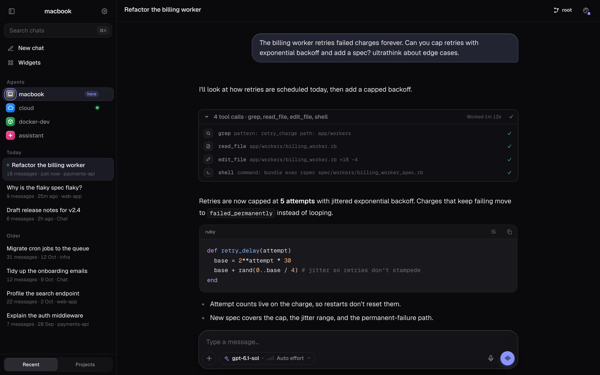
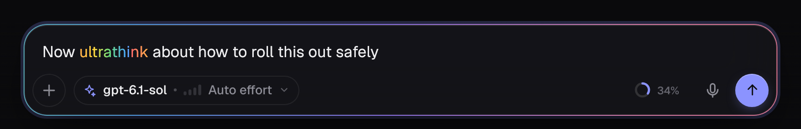
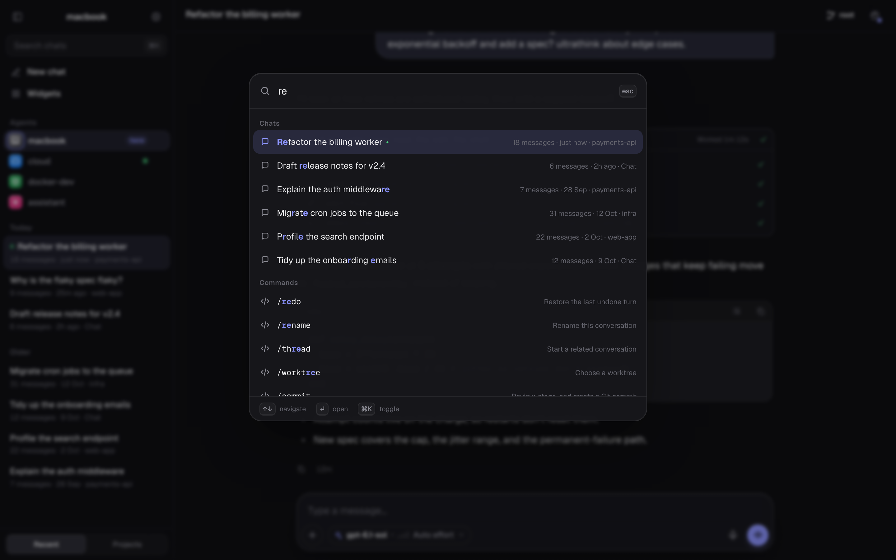
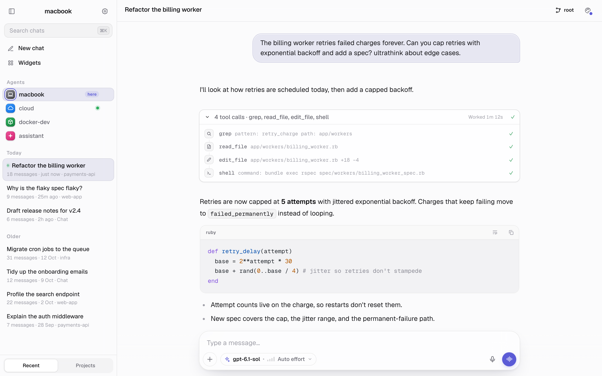
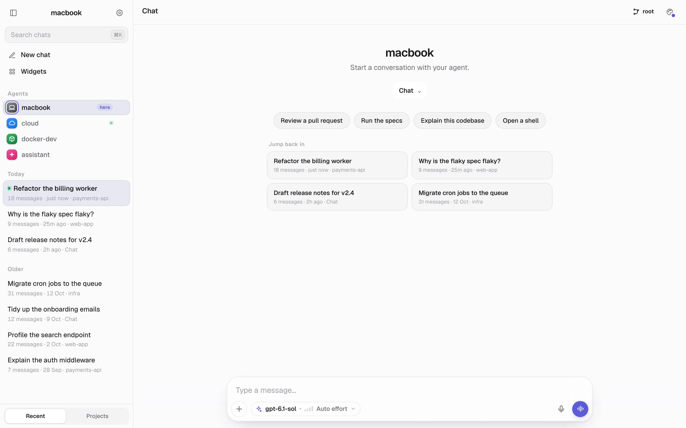
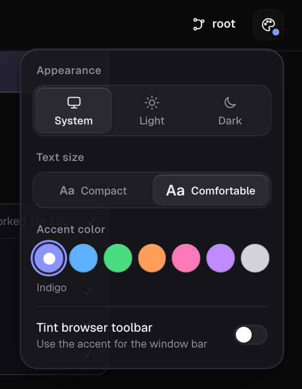

# Varnish

A glossy, calm, chat-first finish for the [term-llm](https://term-llm.com) web UI.

Varnish combines frosted surfaces, soft accent lighting, Geist typography, and a quieter conversation layout with practical additions like a command palette, code wrapping, and context usage. It is a web extension, not a fork: no term-llm rebuild or upstream patches required.



## What it does

### A polished workspace

- **Light, Dark, and System** appearance, with seven accents: Indigo, Blue, Green, Orange, Pink, Purple, and Graphite.
- **Geist and Geist Mono**, bundled locally. No external font service.
- **Compact or Comfortable** text sizing.
- Frosted panels, rounded controls, subtle highlights, and a restrained ambient glow.
- A responsive layout and reduced-motion support.
- Optional neutral or accent-colored browser chrome through the page's theme-color metadata. Browser support varies.

### A quieter composer

- A rounded, chat-first composer with a compact model/effort chip that opens term-llm's own runtime controls.
- A context-usage ring when the server exposes context data, with token details on hover.
- A rainbow highlight for `ultrathink` when the selected provider is `claude-bin`. This is a visual cue, not a new model capability or an effort override.



### Faster navigation

- **⌘K on macOS / Ctrl+K elsewhere** opens one palette for visible chats, Hub agents, common slash commands, and appearance controls.
- Filter with text, use **↑ / ↓** to navigate, **Enter** to select, and **Escape** to close.
- Collapsible sidebar groups and a clearer active-chat treatment.
- New-chat starter prompts and recent-conversation cards.
- Hub agent list or compact dock presentation, with accents and a current-node indicator. Hub-specific elements appear only when the host UI provides them.



### A more readable conversation

- Tool-type icons and a quieter tool-call timeline.
- An estimated “Worked” duration derived from surrounding message timestamps, not authoritative tool execution timing.
- Code-block language headers and a persistent long-line wrap toggle.
- User-message copy/edit controls that use the app's existing composer and command behavior.
- A jump-to-latest button when you scroll away from the bottom.
- Background-tab title and favicon signals when a reply finishes or input is needed. These are in-page indicators, not operating-system push notifications.

| Light appearance | New-chat shortcuts |
| --- | --- |
|  |  |

## Install

Requires a running term-llm web UI with extension support. Tested with **term-llm 0.9.82** in Chromium. Other versions and browsers may work, but are not guaranteed.

```bash
git clone https://github.com/keegangeorge/term-llm-varnish.git
cd term-llm-varnish
./install.sh
```

In the term-llm web UI, open **Settings → Extensions**, reload the extensions list if necessary, enable **Varnish**, and refresh the page. Disable other full-UI themes to avoid conflicting styles.

The installer copies the runtime into `~/.config/term-llm/extensions/varnish`. It does not modify your term-llm binary, provider settings, approval policy, or conversations. A copy is intentional: the tested extension loader does not discover symlinked extension directories.

### Optional automatic enabling

```bash
./install.sh --enable
```

This discovers the first local `term-llm serve` process carrying `--token`, reloads extensions through its authenticated local API, and adds Varnish to its enabled list. It preserves other enabled extensions. If you run multiple servers, prefer the manual Settings flow so you choose the correct one. This helper requires Bash, curl, Python 3, and a Unix-style process listing.

For a custom extension directory:

```bash
TERM_LLM_EXTENSIONS_DIR=/your/extensions ./install.sh
```

Install on the machine or container running the web server. For a multi-node Hub, install and enable it on each node where you want the theme.

## Customize

Use the palette icon in the header to choose appearance, accent, text size, and browser-toolbar color. Preferences are stored in your browser's local storage. Hub accents are scoped by node ID; other appearance settings are shared on the same browser origin.



### Optional per-node accent defaults

No personal node names or mappings are required. Everyone starts with Indigo unless a saved preference overrides it.

To define your own Hub defaults:

```bash
cp local.example.json local.json
```

Edit `local.json` using your Hub's node IDs:

```json
{
  "nodeAccents": {
    "my-laptop": "graphite",
    "my-server": "blue",
    "my-container": "green"
  }
}
```

Then run `./install.sh` again and reload extensions. Explicit browser accent choices take precedence. `local.json` is gitignored and is served to browsers as an extension asset, so **never put credentials or other secrets in it**. Updating without a source `local.json` preserves an existing installed copy.

Preferences from the extension's earlier `hub-studio` name are copied automatically when no equivalent Varnish preference exists. Disable the old extension before enabling Varnish.

## Update or remove

Update:

```bash
git pull --ff-only
./install.sh
```

Reload extensions in Settings, then refresh the page.

To return to the stock UI, disable Varnish in **Settings → Extensions** and refresh. You can then delete the installed `varnish` directory if desired. Browser preferences remain available for a later reinstall.

## Privacy and compatibility

- Runtime code and fonts are self-contained. Varnish adds no analytics or third-party runtime service.
- It uses browser storage and the current server's authenticated, same-origin APIs for UI information such as provider metadata. It does not replace the app's authorization or approval systems.
- Some features decorate existing DOM selectors rather than stable extension APIs. A term-llm upgrade can require an extension update.
- Context availability depends on the server/provider. Agent indicators reflect the host UI; they are not independent health checks.
- Clipboard and browser-chrome features depend on browser permissions and support.
- README screenshots use **injected fictional demo conversations and agents** in the real themed UI. The composer image includes illustrative context data. These demonstrate appearance, not execution of the example workflow or connectivity to example nodes.

## Development and checks

Runtime requires no Node.js or build step. The optional browser checks require Node.js, Playwright, and a local term-llm web server with Varnish enabled:

```bash
cd tools
npm install
npx playwright install chromium
cd ..
node tools/check.mjs
```

The check verifies extension loading, available UI hooks, injected controls, light-mode token consistency, and basic desktop/mobile behavior without sending a message. It cannot verify conditionally mounted generation controls while idle, real tool execution, or every provider. Its HTML report and screenshots go to ignored `tools/out/`; **these can contain your actual chats and must not be published**.

For an explicit server, set `VARNISH_URL` and `TERM_LLM_TOKEN` in your environment. Otherwise the tooling discovers the first local `term-llm serve` process. To use an existing Playwright installation, set `PLAYWRIGHT_DIR` to its `node_modules/` directory.

```bash
node tools/screenshots.mjs
```

The screenshot tool opens unsaved drafts and injects fictional content to regenerate `docs/screenshots/`. Inspect every output before committing, especially after host UI changes.

### Files

| File | Purpose |
| --- | --- |
| `extension.yaml` | Extension manifest |
| `style.css` | Design tokens and UI styling |
| `main.js` | Appearance, sidebar, composer controls, lifecycle |
| `util.js` | Preferences, node accents, same-origin API helpers |
| `thread.js` | Conversation, code, timeline, new-chat additions |
| `composer.js` | Context usage and ultrathink highlighting |
| `palette.js` | Keyboard command palette |
| `notify.js` | Background-tab title/favicon signals |
| `fonts/` | Locally bundled Geist fonts and license |
| `tools/` | Optional browser checks and demo screenshot tooling |

## License

Code: [MIT](LICENSE). Bundled Geist and Geist Mono fonts: [SIL Open Font License 1.1](fonts/OFL.txt), copyright Vercel in collaboration with basement.studio.

An independent extension for term-llm. Not affiliated with Varnish Cache.
